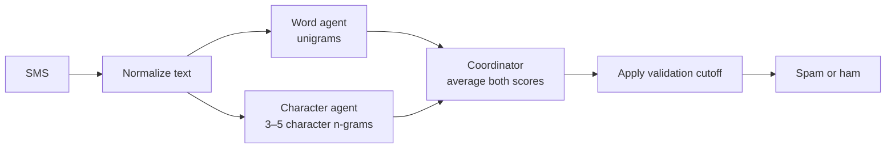
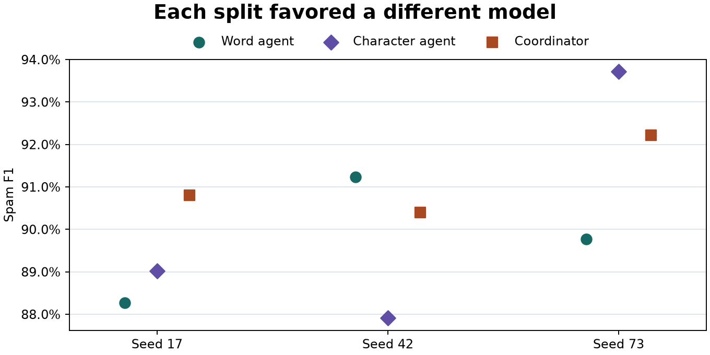
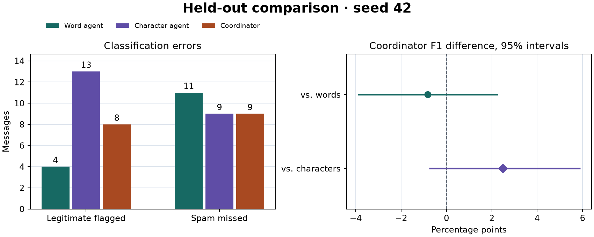

# SMS Spam Agents

[](https://github.com/aaravkalia-88/sms-spam-agents/actions/workflows/ci.yml)

A CPU-only PyTorch experiment by **Aarav Kalia**. Two independently trained linear classifiers score the same SMS using different features. A coordinator averages their scores and returns `spam` or `ham` (legitimate).

**Does combining word and character cues improve spam detection?** The coordinator had the highest F1 on one of three splits. On the primary split it caught two more spam messages than the word agent and raised false alarms from four to eight. The paired 95% interval for its F1 difference contains zero.

[How it works](#how-it-works) · [Results and graphs](#held-out-results) · [Failure analysis](#one-observed-failure) · [Reproduce](#reproduce-and-try-it) · [Software tests](#software-tests)

## How it works



1. **Prepare the dataset.** The Kaggle CSV has 5,572 rows and 5,097 messages remain after deduplication. The grouping key folds case, replaces URLs, emails and digit sequences, and treats runs of punctuation or whitespace as token separators. Deduplication happens before splitting. If identical grouping keys have conflicting labels, every row in that group is discarded.
2. **Split by label.** For each seed, shuffle ham and spam separately and reserve about 15% for validation and 15% for testing. Each run used 3,571 training messages, 763 validation messages and 763 test messages. The test set contained 89 spam messages.
3. **Train the specialists.** The word agent sees whole words. The character agent sees short character sequences that can capture fragments and spelling variation. Each uses 4,096 hashed binary features with unit row norm and a separate `torch.nn.Linear` classifier. Both train for 45 steps with class-weighted binary cross-entropy and AdamW.
4. **Select cutoffs on validation.** Each model emits a sigmoid score. The coordinator takes a fixed equal-weight mean. For each system, the threshold is picked by validation spam F1 on a 0.05–0.95 grid in increments of 0.05. Ties favor a cutoff closer to 0.50. The selected cutoffs stay fixed on the held-out test set.

## Held-out results

The primary comparison uses seed 42. Precision, recall and F1 refer to the spam class. The majority baseline gets **88.34% accuracy while missing every spam message**, so the comparison emphasizes spam F1 and error counts.

| System | Accuracy | Precision | Recall | Spam F1 | False alarms | Missed spam |
| --- | ---: | ---: | ---: | ---: | ---: | ---: |
| Always predict ham | 88.34% | 0.00% | 0.00% | 0.00% | 0 | 89 |
| Word agent | **98.03%** | **95.12%** | 87.64% | **91.23%** | 4 | 11 |
| Character agent | 97.12% | 86.02% | **89.89%** | 87.91% | 13 | 9 |
| Two-agent coordinator | 97.77% | 90.91% | **89.89%** | 90.40% | 8 | 9 |



| Seed | Word F1 | Character F1 | Coordinator F1 |
| --- | ---: | ---: | ---: |
| [17](results/seed-17.json) | 88.27% | 89.02% | **90.80%** |
| [42](results/seed-42.json) | **91.23%** | 87.91% | 90.40% |
| [73](results/seed-73.json) | 89.77% | **93.71%** | 92.22% |



### Paired comparison

The systems predicted on the **same** held-out messages. For each comparison, the code counts the four possible prediction pairs within each true label. It uses 10,000 stratified bootstrap draws from those counts, keeping each pair together and the number of ham and spam messages fixed. The interval spans the 2.5th and 97.5th percentiles of the resampled F1 differences.

Each entry below is **coordinator F1 minus the single-agent F1**, in percentage points, with its 95% interval.

| Seed | Versus word agent | Versus character agent |
| --- | ---: | ---: |
| 17 | +2.54 [−0.74, +6.00] | +1.79 [−1.39, +5.05] |
| 42 | −0.83 [−3.91, +2.26] | +2.48 [−0.77, +5.91] |
| 73 | +2.45 [−0.44, +5.75] | −1.49 [−4.62, +1.65] |

All six intervals include zero. On seed 42 the coordinator recovered two spam messages the word agent missed, added five false alarms and removed one. These paired counts explain the recall gain and lower precision. The JSON reports contain the split sizes, thresholds, confusion counts, paired outcomes and dataset checksum.

### One observed failure

The coordinator missed a cash-giveaway promotion in seed 42 (Kaggle data row 4753, excluding the header). The word agent scored it **0.214** and the character agent **0.479**. The character agent would flag it at its **0.40** cutoff. The coordinator averaged the scores to **0.347**, just below its own **0.35** cutoff. Equal weighting suppressed a correct specialist prediction in this case.

## Reproduce and try it

The reported runs used Python 3.14, PyTorch 2.15, NumPy 2.5.5 and a macOS arm64 CPU. Training and prediction use local files and require no GPU or API key. On Linux, first install the [PyTorch CPU wheel](https://pytorch.org/get-started/locally/) with `python -m pip install torch==2.15.0 --index-url https://download.pytorch.org/whl/cpu` after activating the virtual environment.

```sh
python3.14 -m venv .venv
source .venv/bin/activate
python -m pip install -r requirements-dev.txt

mkdir -p data artifacts
curl -fL 'https://www.kaggle.com/api/v1/datasets/download/uciml/sms-spam-collection-dataset?datasetVersionNumber=1' -o data/sms-spam.zip
unzip -p data/sms-spam.zip spam.csv > data/spam.csv

for seed in 42 17 73; do
  python experiment.py train --csv data/spam.csv --seed "$seed" \
    --model "artifacts/model-$seed.pt" --report "artifacts/seed-$seed.json"
done

python plot_results.py --results-dir artifacts --output-dir artifacts/figures

printf '%s\n' 'Congratulations! Claim your free cash prize now.' |
  python experiment.py predict --model artifacts/model-42.pt
```

The demo returns JSON with the final label (`spam` for this example), each agent's score and the coordinator cutoff. Run `python plot_results.py` to redraw the figures from the checked-in reports without downloading or training on the dataset.

## Software tests

**10 tests passed with 97.65% combined statement and branch coverage** for `experiment.py` in the local run. GitHub Actions uses the same suite with an 80% minimum and verifies that both figures render. Unit and integration fixtures are synthetic.

| Check | What it verifies |
| --- | --- |
| CSV and data split | Required columns, invalid labels, too few samples, normalized duplicates, conflicting labels and deterministic disjoint splits. |
| Feature encoding | Both encoders handle digit substitutions consistently, normalize feature vectors and return zeros for empty input. |
| Evaluation and coordination | Confusion counts, F1, validation threshold selection and equal-weight averaging. |
| Paired analysis | Identical predictions yield a zero-width interval. Disagreements are counted correctly and results reproduce for the same seed. Signed seeds remain accepted. |
| Command line | Train and save a checkpoint, report metrics without raw SMS text, reload for inference, reject blank input and reject output paths that alias the input. |
| Real-data reruns | All three Kaggle reruns reproduced the published model metrics and failure examples. Each paired table accounts for every test message. |

```sh
ruff check .
ruff format --check .
python -m pytest --cov=experiment --cov-fail-under=80
python plot_results.py --output-dir artifacts/figures
```

## Code map

| Path | Role |
| --- | --- |
| [experiment.py](experiment.py) | Data preparation, feature hashing, PyTorch training, threshold selection, paired bootstrap and prediction CLI. |
| [test_experiment.py](test_experiment.py) | Synthetic fixtures and regression checks for the pipeline and analysis. |
| [plot_results.py](plot_results.py) | Builds the two figures from aggregate JSON. |
| [results/](results/) | Three seed reports with metrics, paired outcome counts and run provenance. |
| [GitHub Actions](.github/workflows/ci.yml) | Runs lint, format, coverage and a smoke test that renders both charts. |

## Limits

The three test sets overlap and come from one historical English-language corpus. Similar campaigns can still cross splits after deduplication. Each interval describes held-out sampling uncertainty for fixed trained models at the observed class counts. The scores are uncalibrated, and the coordinator uses two classifiers' parameters. A newer external corpus and splits grouped by campaign would test whether the tradeoff holds beyond this dataset.

## Data and license

The benchmark uses version 1 of the [Kaggle SMS Spam Collection](https://www.kaggle.com/datasets/uciml/sms-spam-collection-dataset), a mirror of the corpus by Tiago Almeida and José María Gómez Hidalgo. The [original UCI dataset](https://doi.org/10.24432/C5CC84) is credited under CC BY 4.0. This repo contains source code, aggregate results and figures. The [MIT license](LICENSE) covers the project code.
